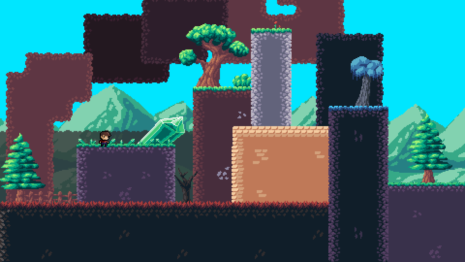

# MindTaker

An early Pygame platformer with pixel art, double jumps, ramps, and parallax
backgrounds. Maps use the JSON format from my [level editor](https://github.com/1Kori256/level_editor).



## Run

Requires Python 3.10+.

```sh
python3 -m venv .venv
source .venv/bin/activate
python -m pip install -r requirements.txt
python main.py
```

On Windows, activate with `.venv\Scripts\activate`.

- **A/D or arrow keys:** move
- **Space:** jump; press again for a double jump
- **R:** restart from spawn
- **Escape/F1:** quit

Falling automatically respawns the player. Reaching the finish resets the level.
The game renders at 480×270 and scales to a 960×540 window with crisp pixels.
Movement, gravity, animations, and camera smoothing run at 60 fixed steps per second.

To play another map exported from the editor:

```sh
python main.py --level data/test1.json
```

## Implementation

Tile images, collision rectangles, and transformed sprites are cached. Drawing
keeps the original depth order and tile offsets; collisions query the player's
surroundings independently of the camera. Ramp contacts, ceiling hits, respawning,
and simultaneous effect cleanup have regression tests.

A local scrolling-map benchmark reduced tile rendering and collision-query work
from about 0.57 ms to 0.19 ms per frame. This excludes player updates, display
scaling, and the frame cap. The art, map files, movement values, and double-jump
mechanic are preserved.

```sh
python -m unittest discover -s tests -v
python tools/benchmark.py --preview docs/preview.png
```

Tests and the benchmark run headlessly. Thanks to
[DaFluffyPotato](https://github.com/DaFluffyPotato) for the original Pygame guidance
and parts of the source code.
